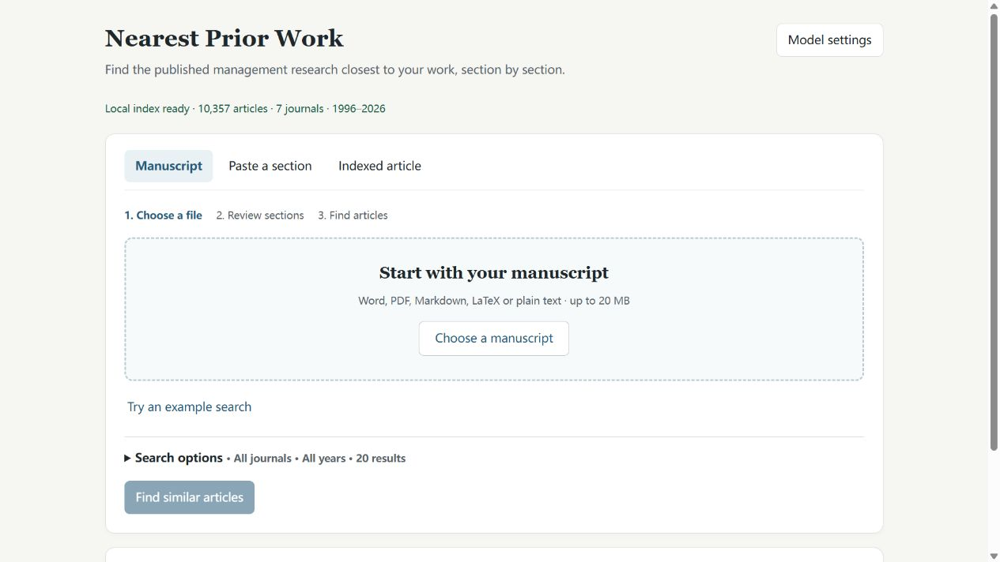

# Nearest Prior Work

Find the published management research closest to your work, section by section.

This is a **local application**. The repository includes an index of 10,357 articles from seven management journals, covering 1996–2026. Search runs on your computer. There is no hosted edition, account registration, index service key, or separate article-index download.



## First successful search

You do not need to install Python or use a terminal. Allow about **15 GB free**, including space on your system drive, and keep internet connected during first setup.

Supported systems are **Windows 10 and 11 on x64 computers**, and **Apple silicon (M-series) Macs with macOS 14 or later**. A GPU is optional. Allow **16 GB RAM for comfortable manuscript use**; smaller-memory computers may be slower. Intel Macs, Windows on ARM and Linux are not supported by this release. See [platform notes](docs/platforms.md).

1. Download this repository with **Code → Download ZIP** and extract the entire ZIP into a normal folder, such as Documents.
2. **Windows:** double-click `start.bat`. **Mac:** double-click `start.command`. A window opens and sets everything up, which can take several minutes or longer. Keep that window open. If your computer warns about a downloaded file, see [troubleshooting](docs/troubleshooting.md).
3. Your browser opens the app, and the search files start downloading by themselves (about 2.3 GB, once). Progress and retry are shown on the page. DOI searches work while this runs.
4. Open **Model settings**, connect your installed and signed-in CLI or your API key, choose **Test connection**, then **Use these settings**. For Codex CLI, leave Model blank to use its default.
5. Choose `examples/demo_manuscript.docx`, inspect the local preview and choose **Identify sections**. Review the section roles, then choose **Find similar articles** after preparation completes.
6. Wait for **Search complete**, inspect the results and choose **Export CSV**.

The example is synthetic. Identifying its sections uses your own model allowance. The **Try an example search** shortcut is a DOI demonstration and does not call a model.

See the [step-by-step quickstart](docs/quickstart.md) for CLI installation/login and API configuration, or [troubleshooting](docs/troubleshooting.md) if a step stops. The launcher uses a suitable Python if you already have one (3.11–3.13). Otherwise it downloads a private copy into the app folder, verifies it and leaves the rest of your computer unchanged.

Later launches reuse the installation. The app normally opens at `http://127.0.0.1:8800`; it reopens a matching running instance or chooses another address if occupied. Local text and DOI retrieval work offline after preparation. Cloud CLI/API identification still needs internet access.

## Use

**Manuscript.** Choose a Word, text-based PDF, Markdown, LaTeX or plain text file. The app extracts and previews text locally, without calling a language model. Configure your model, then choose **Identify sections**. Expand the identified sections to inspect their original text, change their roles or exclude them. Choose **Find similar articles** to search locally.

**Paste a section.** Paste an abstract, theory section, method passage or other text, and choose what to compare it with. This does not call a language model.

**Indexed article.** Enter the DOI of an article in the bundled collection. The collection does not contain every article from the seven journals, so the page lists what it covers and offers **Paste a section** when a DOI is not found. This uses existing section vectors, excludes the source article, and does not call a language model or an external metadata service.

Search options filter journals and years and select the number of results. **Find closest by** searches the full eligible collection for the selected section; it does not merely reorder an earlier result list. CSV exports and copied DOIs follow the displayed order. Exports include the index version, ranking dimension and filters, but not submitted manuscript text.

## Connect your language model

Open **Model settings**. This is needed only to identify manuscript sections.

- **My AI subscription:** the dialog links to official Codex CLI or Claude Code installation instructions, and shows a **Setup guide** with only the steps still needed. It checks again when you return to the page, and selects a CLI that is already signed in. Install and sign in first, then test the connection. The default model can be left blank. The app invokes the agent with tools disabled, temporary working files and no persistent session. Usage counts toward the user's plan.
- **API key:** choose a provider, enter your key, then **Load available models** and choose a chat-capable model. If the provider cannot list models, enter the exact model ID from its console. For a custom OpenAI-compatible service, its **API base URL** is shown directly in the form. API usage is billed by your provider.
- **Local model:** connect a running Ollama instance if you want section identification to stay on your computer as well.

**Use these settings** saves the configuration without making a model call. **Test connection** makes one small call and requires a usable reply; an empty HTTP success is not accepted. Installation detection is separate from connection testing. Model requests show elapsed time and offer **Cancel request**. Cancellation keeps your inputs; work already processed by the provider may count toward your allowance. Canceling local retrieval stops waiting, and processing may finish in the background.

Provider and model settings can be remembered. API keys stay in page memory by default. Saving a key in browser storage requires a separate checkbox; **Clear saved settings** removes it. The app does not write model keys or manuscript text to its logs.

When using a cloud CLI or API, extracted manuscript text goes to that provider for section identification. Excluding a section afterward prevents it from entering the similarity search; it does not undo the prior model request. Local retrieval alone does not send text to a model provider.

## Results

The collection includes Academy of Management Journal, Academy of Management Review, Administrative Science Quarterly, Journal of Management, Management Science, Organization Science and Strategic Management Journal.

Results show article metadata and section similarity scores. They do not contain abstracts or article full text. Years reflect the indexed publication metadata and may be online-first years. Some articles have missing DOI or year metadata; these are preserved in the index.

- List positions use the current ranking and filters. Detailed section ranks refer to the whole index of articles with that section, excluding the source article for DOI searches.
- Overall similarity averages standardized section scores over the sections both articles have. Coverage is shown explicitly; missing sections are not scored as zero.
- Percentiles compare with random article pairs, not the percentage of matching content. Short passages should primarily be judged by rank.
- Similarity is a starting point for reading, not a novelty verdict. Opening a DOI link uses the publisher's website and requires internet access.

## Optional local Agent tools

The same local index can be used inside an MCP-compatible agent. After installation, add `npw-mcp` as a local stdio tool. No server URL or application API key is needed. For example:

```json
{"mcpServers":{"nearest-prior-work":{"command":"npw-mcp"}}}
```

If the command is not on the agent's PATH, use the full path to the virtual environment's `npw-mcp` executable. Tools are `outline_manuscript`, `find_similar_to_manuscript`, `find_similar_articles`, and `get_article`. Your agent reads numbered paragraphs and marks section boundaries; the software cuts original text and searches locally.

## Development and reproducibility

Use the launcher to create the isolated environment first, then install test tools in that environment:

```powershell
# Windows, from the repository folder
.venv\Scripts\python.exe -m pip install -c constraints.txt -e ".[test]"
.venv\Scripts\python.exe -m pytest -q
.venv\Scripts\python.exe tools/check_release.py
```

On macOS, use `.venv/bin/python` for the same commands. Tests use synthetic vectors and mocked providers; CI never calls a real language model. See [contributing and release checks](CONTRIBUTING.md) and [technical details](docs/local_app.md).

The runtime supports Python 3.11–3.13. See [platform notes](docs/platforms.md) for the difference between actual runtime checks and dependency checks. CI includes CPU installation/tests and an optional real retrieval check without LLM calls.

## License and data

The project's original code, documentation, synthetic examples and original index contributions use the [MIT License](LICENSE). See [data provenance and third-party scope](DATA_NOTICE.md) for the bundled index. The license does not grant rights to the underlying journal articles or replace dependency and model-provider terms.
